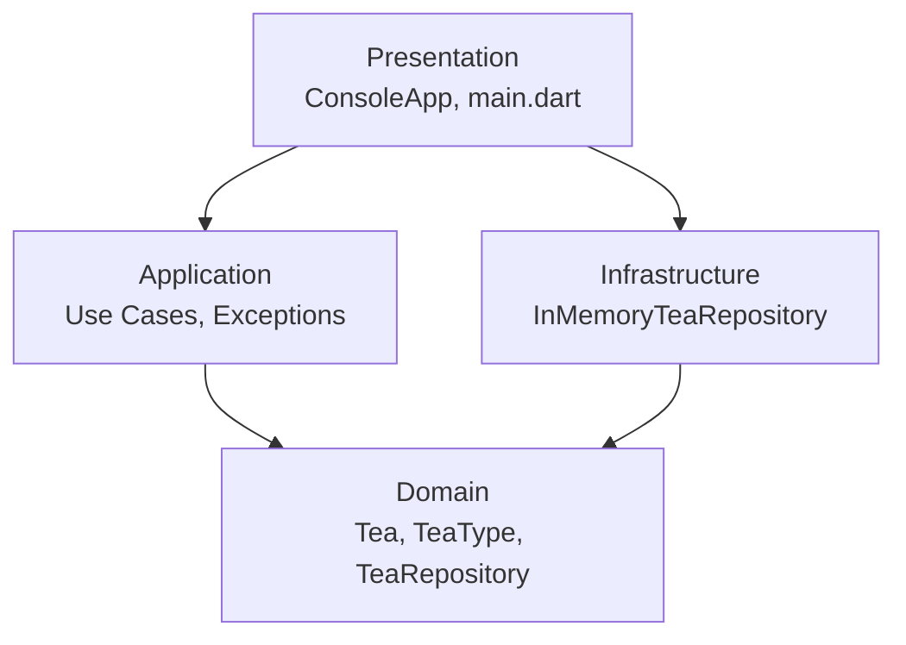

# Tea Journal

Консольний застосунок «Чайний журнал» на Dart/Flutter: облік чаїв із типом, температурою та часом заварювання, оцінкою й нотатками. Побудований за принципами Clean Architecture.

## Архітектура



Залежності спрямовані до центру: Domain не залежить ні від чого. Application працює лише з інтерфейсом `TeaRepository`, а його реалізація `InMemoryTeaRepository` живе в Infrastructure (принцип інверсії залежностей).

## Структура проєкту

```
lib/
├── domain/
│   ├── entities/        # Tea, TeaType
│   └── repositories/    # TeaRepository (інтерфейс)
├── application/
│   ├── use_cases/       # Add, GetAll, Update, Delete
│   └── exceptions/      # TeaNotFoundException
├── infrastructure/
│   ├── config/          # storage_config.dart
│   └── repositories/    # InMemoryTeaRepository
└── presentation/
    ├── console_app.dart # консольне меню
    └── main.dart        # точка входу, Dependency Injection
```

## Збірка та запуск

1. Встановіть [Flutter SDK](https://docs.flutter.dev/get-started/install).
2. Завантажте залежності:
   ```bash
   flutter pub get
   ```
3. Перевірте код:
   ```bash
   flutter analyze
   ```
4. Запустіть застосунок:
   ```bash
   dart run lib/presentation/main.dart
   ```

## Гілкування

- `main` — стабільний код;
- `develop` — інтеграційна гілка;
- `feature/*` — гілки під конкретні задачі (по одній на кожен шар).